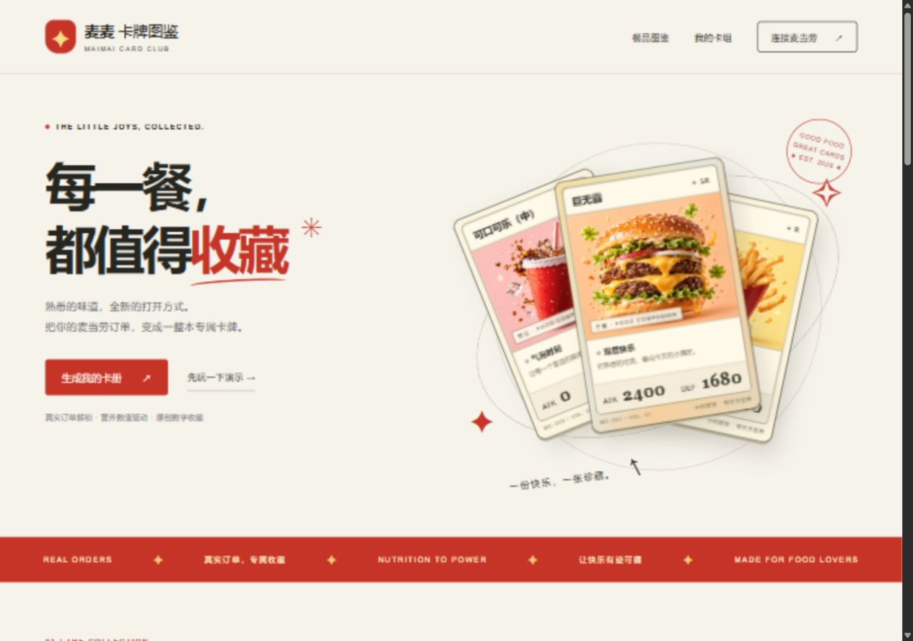

# ✦ 麦麦卡牌图鉴 · McD Card Collection

**每一餐，都值得收藏。** 把麦当劳餐品营养变成卡牌属性，把个人 MCP 近期订单变成原创数字收藏。



适合喜欢餐品收藏、卡牌和日常记录的用户。独立开发者参赛作品，非麦当劳官方发行；卡牌无兑换权益。不为收藏增加消费，珍惜每一餐。

## 体验

- 原创餐品插画、复古卡框、翻卡解锁、餐品分类与搜索。
- 使用自己的 MCP Token 查询真实订单和营养；界面从 MCP 实时发现参数，不把演示数据当成真实订单。
- 六种首发卡：巨无霸、中薯条、中杯可乐、麦乐鸡、圆筒冰淇淋、猪柳蛋麦满分。
- 从已收藏餐品中选择三张组成招牌卡组，可导出单卡和卡组 PNG。
- 无 Token 可点击“先玩一下演示”；所有演示营养数值均为示例，非官方数据。

## 本地启动

需要 **Node.js 22 或更新版本**。项目零第三方运行依赖，无需 npm install。

```powershell
npm start
```

打开 http://localhost:3000 。点击“生成我的卡册”，在 [麦当劳官方平台](https://open.mcd.cn/mcp) 申请个人 Token 后输入。连接成功后自动查询订单与营养，并补齐必要订单详情，无需填写技术参数。Token 不要粘贴到 GitHub Issue、聊天记录或公开文档。

```powershell
npm test
npm run build
cd site
npm run validate
```

## 卡牌规则

每份蛋白质 g ×100 → ATK；每份碳水 g ×40 → DEF，四舍五入。属性是娱乐换算，不代表健康评分。缺少营养、单位、每份口径时展示“待补全”。

确认完成且未取消/退款的订单才计入；套餐按历史实际子项，未知餐品待识别。同一订单去重，重复餐品记录份数而不升级战力。当前收藏在连接内存中，刷新或断开后清除。

## 真实接入状态

已实现 MCP 协议、工具发现、自动同步与保守的数据适配。**真实 Token 连接和工具发现已成功，已读取到 10 笔订单；完整发卡尚未验收，真实状态、规格与营养返回结构仍需验证。** 查看 [MCP_INTEGRATION.md](MCP_INTEGRATION.md) 了解具体支持范围。未知结构不发虚假卡牌。普通用户无需填写工具参数：同步自动调用无参工具，并从订单列表提取订单号补齐详情。

## Skill 使用

将本仓库作为技能目录导入支持 SKILL.md 的客户端，配置 `mcp-config.example.json` 对应的麦当劳 MCP（环境变量占位符解析方式以客户端为准）。可输入：

- “把我的麦当劳订单变成卡牌。”
- “解释巨无霸的卡牌属性和营养口径。”
- “用我已收藏的三种餐品生成快乐三件套。”

技能说明见 [SKILL.md](SKILL.md)。网页和 Skill 共用同一概念及换算规则。

## 部署

`site/` 是独立可部署应用。`npm run build` 生成 `site/dist/server/index.js`，包含前端、图片和 MCP 后端的 Worker ESM；可通过已配置的 Sites 托管流程发布。不能仅将静态页面上传到 GitHub Pages 就声称支持真实 MCP 后端。

本地 Node 服务默认只监听回环地址；自托管可设置 HOST=0.0.0.0 和 PORT，并配置 HTTPS 反向代理及合理的请求速率限制。线上数据依赖用户个人 Token，不使用开发者 Token 兜底。

## 参赛与 WorkBuddy

- 官方参赛声明保留在 CONTEST_DECLARATION.md；MCP 配置只提供环境变量占位符。
- [workbuddy.md](workbuddy.md) 当前是待补充的真实对话骨架。本次实现由 Codex 完成，不能冒充 WorkBuddy 开发记录。
- 使用 [WORKBUDDY_PROMPT.md](WORKBUDDY_PROMPT.md) 在 WorkBuddy 中继续真实联调、修改或验收，然后导出实际脱敏上下文；能否取得专项积分取决于官方完整规则和审核。
- 尚未创建公开 GitHub 仓库、提交报名 Issue；公开比赛展示需要可访问的 Demo、截图和仓库地址。

## 素材

餐品插画通过内置 imagegen 工具生成，落盘为 `site/public/art.png`；原始提示词与用途见 [docs/ARTWORK.md](docs/ARTWORK.md)。卡框、排版和交互为代码实现，未复制第三方卡牌素材。餐品画面为风格化示意，非官方商品照片。

